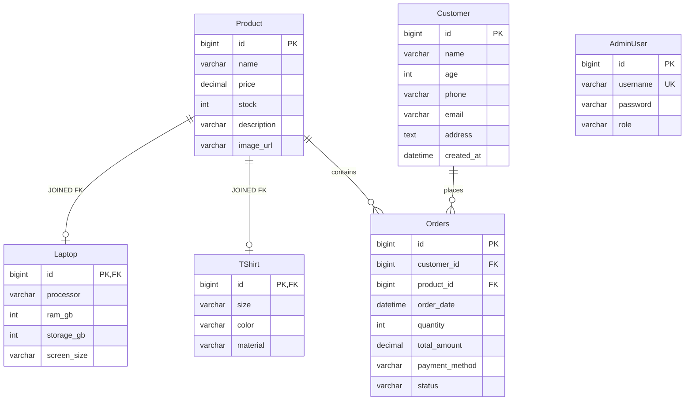

# 🛒 Amazon-Style E-Commerce Web Application

A full-stack, minimal Amazon-style e-commerce mini-project built with **Java Servlets (Jakarta EE 11)**, **JSP**, **Hibernate ORM**, and **MySQL 8.0**, running on **Apache Tomcat 11**.

The user interface features an **Orange and Black** Amazon-inspired theme (`#131921` dark navy and `#f08804` orange accents), complete with polymorphic product management, a streamlined Cash-on-Delivery checkout flow, and a session-protected administrator portal.

---

## 📸 Key Features

- **🛍️ Product Catalog**:
  - Displays products retrieved polymorphically using **Hibernate JOINED Table Inheritance** (`Product` base entity with `Laptop` and `TShirt` sub-entities).
  - Subclass-specific specifications rendered dynamically (e.g., Processor, RAM, Storage, Screen Size for Laptops; Size, Color, Material for Apparel).
  - Real-time stock status badge and direct **Buy Now** actions.

- **📦 Streamlined Checkout (Cash on Delivery)**:
  - Clicking **Buy Now** routes to a dedicated checkout page.
  - Collects essential customer details: **Name, Age, Phone, Email, and Delivery Address**.
  - Displays selected product summary with guaranteed **Cash on Delivery (COD)** payment terms.
  - Atomic Hibernate transaction: checks stock, decrements inventory, saves customer record, and generates the order.

- **🧾 Order Confirmation Receipt**:
  - Clean Amazon-style confirmation receipt with generated Order ID, delivery timeline, recipient details, and itemized total.

- **🔒 Admin Portal & Dashboard**:
  - Admin login page (`/admin/login`) with credential validation via Hibernate HQL.
  - Protected admin dashboard (`/admin/dashboard`) showing live order history, customer contact information, delivery addresses, and order status.
  - Session-based authentication with secure logout.

---

## 🛠️ Technology Stack

| Layer | Technology |
| :--- | :--- |
| **Backend / Web** | Java 11+ / Jakarta Servlet API 6.1.0 / Jakarta JSTL 3.0 |
| **ORM / Persistence** | Hibernate Core 5.6.15.Final / JPA Annotations |
| **Database** | MySQL 8.0 (MySQL Connector/J 8.0.33) |
| **Application Server** | Apache Tomcat 11.0 |
| **Build & Dependency Tool** | Apache Maven 3.x |
| **Frontend UI / Styling** | JSP, Bootstrap 5.3, Bootstrap Icons |

---

## 🗄️ Database Schema & Inheritance

The project models polymorphic products using the **JPA `InheritanceType.JOINED`** strategy in MySQL 8.0:



---

## 📂 Project Structure

```text
├── src
│   └── main
│       ├── java
│       │   └── com
│       │       └── ecommerce
│       │           ├── Main.java                 # Standalone CLI / test runner
│       │           ├── dao
│       │           │   ├── AdminDAO.java         # Admin authentication via HQL
│       │           │   ├── OrderDAO.java         # Order & customer persistence
│       │           │   └── ProductDAO.java       # Polymorphic catalog operations
│       │           ├── model
│       │           │   ├── AdminUser.java        # Admin credentials entity
│       │           │   ├── Customer.java         # Customer details entity
│       │           │   ├── Laptop.java           # Subclass entity (JOINED)
│       │           │   ├── Order.java            # Order entity linked to Customer & Product
│       │           │   ├── Product.java          # Base Product entity
│       │           │   └── TShirt.java           # Subclass entity (JOINED)
│       │           ├── servlet
│       │           │   ├── AdminServlet.java     # /admin/login, /admin/dashboard, /admin/logout
│       │           │   ├── CheckoutServlet.java  # /checkout (GET form, POST place order)
│       │           │   └── ProductCatalogServlet.java # /products, /catalog, /
│       │           └── util
│       │               └── HibernateUtil.java    # Thread-safe SessionFactory singleton
│       ├── resources
│       │   └── hibernate.cfg.xml                 # MySQL 8.0 & Hibernate mappings
│       └── webapp
│           ├── WEB-INF
│           │   └── web.xml                       # Servlet mappings & session timeout
│           ├── admin-dashboard.jsp               # Admin order history view
│           ├── admin-login.jsp                   # Admin credentials form
│           ├── checkout.jsp                      # Customer details & COD checkout
│           ├── index.jsp                         # Orange & Black product catalog
│           └── order-success.jsp                 # Order confirmation receipt
├── schema.sql                                    # MySQL DDL & seed data script
├── workbench_instructions.md                     # Step-by-step MySQL Workbench guide
├── run-tomcat.bat                                # Quick launcher for Tomcat 11
└── pom.xml                                       # Maven build configuration
```

---

## 🚀 Getting Started

### 1. Prerequisites
- **Java Development Kit (JDK)**: Java 11 or higher (Java 21 supported)
- **Apache Maven**: 3.6+
- **MySQL Server**: 8.0 running on `localhost:3306`
- **Apache Tomcat**: 11.0 (Jakarta EE 11 compatible)

---

### 2. Database Setup

1. Open your MySQL client (MySQL Workbench or command-line client).
2. Execute the included [`schema.sql`](schema.sql) file:
   ```sql
   SOURCE path/to/project/schema.sql;
   ```
   *For step-by-step screenshots and guide using MySQL Workbench 8.0 CE, refer to [`workbench_instructions.md`](workbench_instructions.md).*

3. Verify or update your database credentials in [`src/main/resources/hibernate.cfg.xml`](src/main/resources/hibernate.cfg.xml):
   ```xml
   <property name="connection.url">jdbc:mysql://localhost:3306/ecommerce_db?useSSL=false&amp;serverTimezone=UTC&amp;allowPublicKeyRetrieval=true</property>
   <property name="connection.username">root</property>
   <property name="connection.password">YOUR_MYSQL_PASSWORD</property>
   ```

---

### 3. Build the Project

Build the WAR package using Maven:

```bash
mvn clean package
```

This compiles all classes and produces `target/ecommerce-catalog.war`.

---

### 4. Running the Application

#### Option A: Using the provided launcher script (Windows)
Run the automated launcher batch script:
```cmd
run-tomcat.bat
```

#### Option B: Deploying manually to Tomcat 11
1. Copy `target/ecommerce-catalog.war` into your Tomcat `webapps/` folder:
   ```bash
   cp target/ecommerce-catalog.war $CATALINA_HOME/webapps/
   ```
2. Start Tomcat:
   - **Windows**: `%CATALINA_HOME%\bin\startup.bat`
   - **Linux / macOS**: `$CATALINA_HOME/bin/startup.sh`

---

## 🌐 Application Endpoints

Once Tomcat is running, access the application in your browser:

| Page | URL | Description |
| :--- | :--- | :--- |
| **Catalog / Home** | `http://localhost:8080/ecommerce-catalog/` | Amazon Orange & Black storefront |
| **Checkout Page** | `http://localhost:8080/ecommerce-catalog/checkout?productId=1` | Customer delivery & COD checkout |
| **Admin Login** | `http://localhost:8080/ecommerce-catalog/admin/login` | Secure admin login |
| **Admin Dashboard**| `http://localhost:8080/ecommerce-catalog/admin/dashboard` | View all placed customer orders |

### Default Admin Credentials
- **Username**: `admin`
- **Password**: `admin123`

---

## 🧪 Running the Standalone CLI Demo

The project also includes a standalone verification runner ([`Main.java`](src/main/java/com/ecommerce/Main.java)) that queries products and tests database operations from the terminal:

```bash
mvn exec:java
```

---

## 📜 License
This project is open-source and available under the [MIT License](LICENSE).

